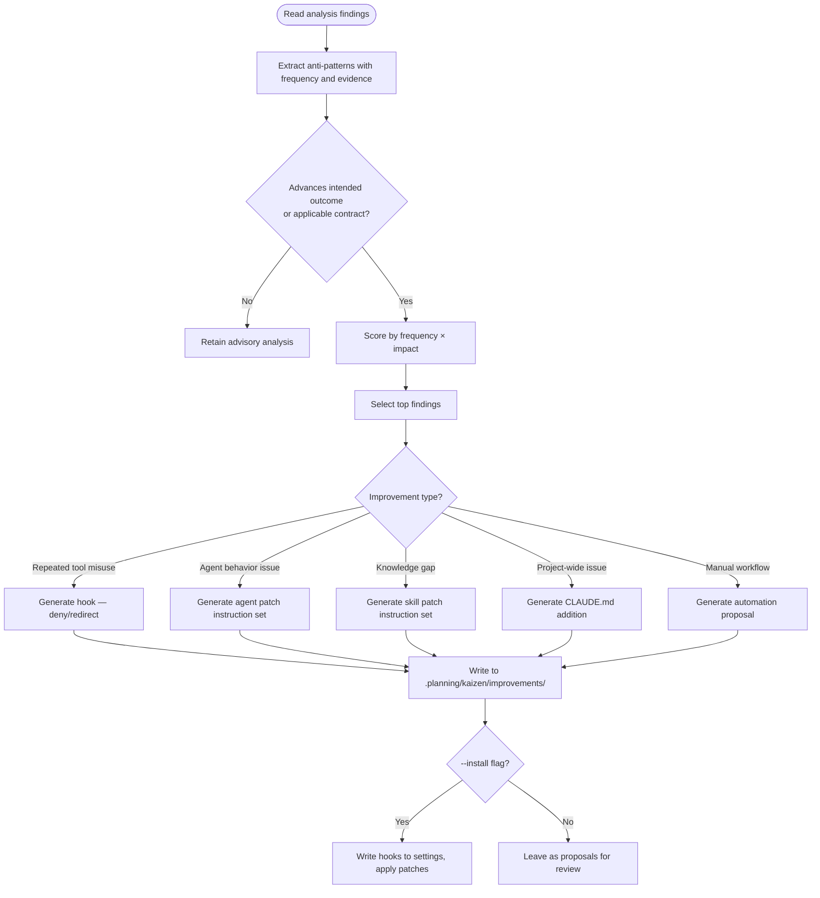

# Kaizen Improvement

Transform analysis findings from `.planning/kaizen/` into actionable improvements — hooks, agent patches, skill refinements, CLAUDE.md updates, and automation scripts.

**Prerequisite:** Analysis findings must exist in `.planning/kaizen/` (generated by the transcript-analysis skill).

## Proposal Admission

Keep the audit's full set of findings. Turn a finding into a hook, agent, skill,
CLAUDE.md, or script proposal only when it advances an intended outcome or an
applicable contract. Each selected proposal records:

- the affected intended outcome or contract;
- observed harm, with its evidence;
- the improvement's material side effects; and
- one focused scenario that would expose the harm and the proposed correction.

Record observations without that connection as advisory analysis. They do not
become patches, install candidates, or new gates. An explicitly requested broad
process audit or improvement scope remains in scope; this check only separates
its proposals from its advisory observations.

## Improvement Types

Each category of output below has a delegation template:

1. **Hook generation** — PreToolUse deny/redirect, SubagentStart context injection, Stop quality gates
2. **Agent prompt refinement** — surgical fixes to agent system prompts via @subagent-refactorer
3. **Skill patches** — add missing knowledge to skills via /plugin-creator:skill-creator
4. **CLAUDE.md updates** — project-wide behavioral rules
5. **Script automation** — replace repeated manual workflows with scripts or skills

For detailed templates and examples, see [Improvement Templates](./references/improvement-templates.md).

For the Autonomous Refinement Loop (ARL) knowledge base — Layer 3 implementation details, prerequisites, and research synthesis — see [ARL Knowledge](../../references/arl.md).

## Workflow

## Hook Generation

Read findings → generate hook configuration + optional script. For patterns mapped to each anti-pattern type, guidelines, and examples, see [Hook Patterns](./references/hook-patterns.md).

## Delegation Protocol

Improvements are instruction sets for specialist agents, not direct edits. Follow outcome-focused delegation:

- Describe the problem with evidence (session IDs, tool calls, frequency)
- State the affected intended outcome or applicable contract, observed harm, material side effects, and focused exposing scenario
- Let the specialist agent determine the implementation approach
- Never prescribe specific code changes in the delegation prompt

## Output Modes

### Draft mode (default)

Write all proposals to `.planning/kaizen/improvements/` as markdown files. Each file contains:

- Finding summary with evidence
- Affected intended outcome or applicable contract
- Observed harm, material side effects, and focused exposing scenario
- Proposed improvement
- Delegation prompt for the appropriate specialist agent
- Priority score

### Install mode (--install flag)

For qualified hooks only — write directly to `.claude/settings.json` or `hooks/hooks.json`. The user's `--install` authorizes this write; other improvement types always produce delegation prompts (never direct edits).

## Priority Scoring

Rank admitted proposals by:

1. **Frequency × Impact** — occurrences across sessions × cost per occurrence; it prioritizes proposals and does not expand the original task or create a new gate
2. **Automation potential** — hooks > scripts > documentation
3. **Blast radius** — project-wide > single-agent > single-session
4. **Implementation cost** — hook (minutes) < CLAUDE.md (minutes) < skill (hours) < agent (days)
