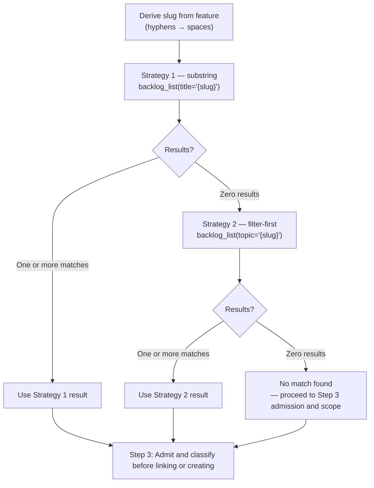
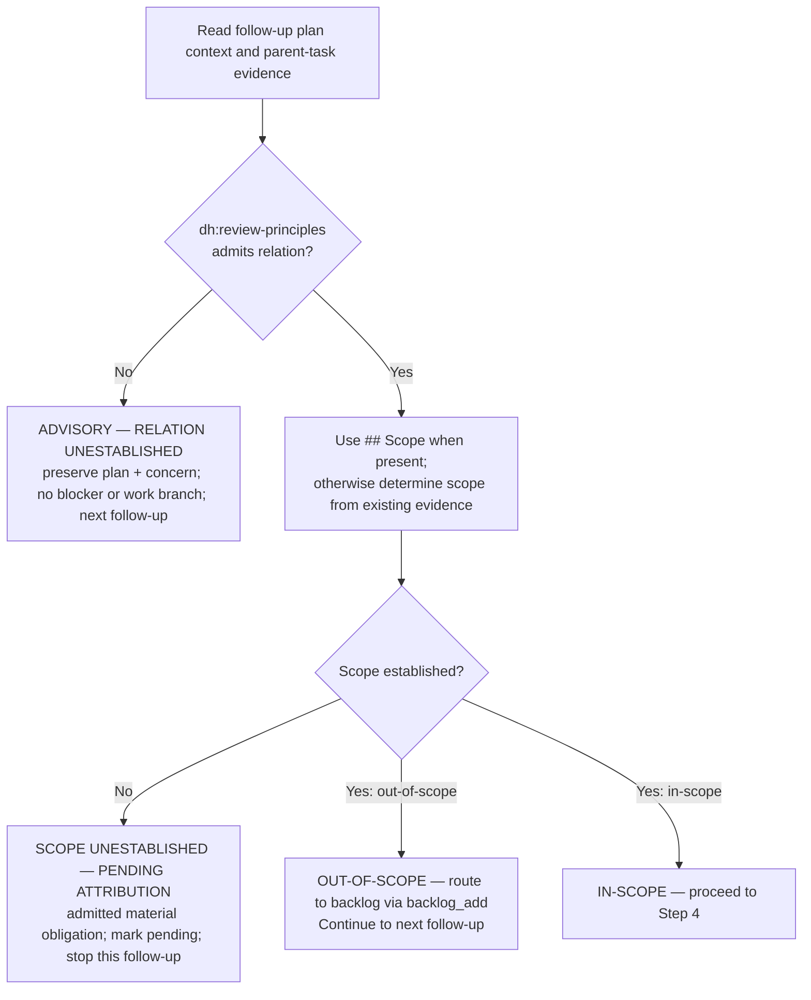

# Recursive Follow-up Handling: Steps 2–5

After Step 1 (Detect Follow-up Files) confirms follow-ups exist, execute these steps in order.

### Step 2: Search Backlog by Title Keywords

For each follow-up plan, store the opaque `plan_ref` returned by
`sam_plan(config={"action": "list", "search": "{parent_slug}-followup"})` as
`{followup_plan_address}`. Derive a search slug from that result's `feature` field:

```text
Input:  feature = "data-validation-followup-1"   (from sam_plan list result)
Step 1: Strip -followup-{k} suffix  --> data-validation
Step 2: Replace hyphens with spaces --> data validation
Output: "data validation"
```

Search the backlog using a 2-strategy fallback chain. Strategy 3 (LLM semantic match) is
**explicitly excluded** from follow-up routing: follow-up features are machine-derived slugs,
not human semantic queries, so LLM semantic selection would have low fidelity against
human-authored backlog titles.

The following diagram is the authoritative procedure for Step 2 backlog search strategy. Execute steps in the exact order shown, including branches, decision points, and stop conditions.



**Strategy 1 — substring via `title=`**

```bash
backlog list --title "{derived_slug}"
```

Parse the JSON output. For each item, check if the derived slug appears (case-insensitive
substring match) in the item's `title` field. If one or more items match, use the first
match as the result and skip Strategy 2.

**Strategy 2 — filter-first via `topic=`**

If Strategy 1 returns zero matches, run:

```bash
backlog list --topic "{derived_slug}"
```

The `topic` parameter performs a case-insensitive substring match against `metadata.topic`.

If Strategy 2 returns one or more items, use the first match.

If both strategies return zero results, retain "no match found" and proceed to Step 3 admission and scope before deciding whether Step 4 may create work.

**Error handling**: If either `backlog list` call above fails, log the error, skip
that strategy, and continue to the next strategy (or to Step 3 admission as "no match found" if all
strategies fail). If the follow-up plan's `feature` field does not match the expected
`{slug}-followup-{k}` pattern, log a warning and use the full `feature` value (with hyphens replaced by spaces) as the derived slug.

### Step 3: Classify Follow-up Findings

For each follow-up plan, read its `context` field via
`sam_plan(plan="{followup_plan_address}", config={"action": "read"})`, then load
`dh:review-principles` before classifying scope or creating backlog work. That skill owns the
admission record and the decision whether the concern can become a blocker or another work branch.

1. Establish the relation to the parent task from the existing follow-up plan and parent-task
   evidence. If it is not established, emit
   `ADVISORY — RELATION UNESTABLISHED: {followup_plan_address}`. Preserve the plan reference and
   concern in the caller's existing report, but do not add it to `{pending_followup_plan_addresses}`,
   create or link backlog work, recurse, or block completion. Continue to the next follow-up.
2. Once the relation is admitted, classify scope. Use `## Scope` when the context supplies it;
   when it does not, determine scope from the existing plan and parent-task evidence. The absence
   of that heading alone neither rejects the relation nor permits completion. If the available
   evidence cannot establish scope, emit
   `SCOPE UNESTABLISHED — PENDING ATTRIBUTION: {followup_plan_address}`, preserve the same
   information, add its address to `{pending_followup_plan_addresses}`, and do not create, link,
   recurse, or silently discard it.
3. An admitted out-of-scope follow-up routes to backlog via `backlog_add` and continues to the
   next follow-up. An admitted in-scope follow-up proceeds to Step 4.

The following diagram is the authoritative procedure for Step 3 Classify Follow-up Findings. Execute steps in the exact order shown, including branches, decision points, and stop conditions.



Out-of-scope backlog_add call pattern:

```text
backlog_add(
    title="{derived_title}",
    body="Quality gate follow-up from {item_ref}",
    labels=["type:task"],
    source="Quality gate follow-up from {item_ref} — out-of-scope: plan {followup_plan_address}"
)
```

Output: `Out-of-scope finding routed to backlog: {title}`

### Step 4: Link or Create Backlog Item

Based on Step 2 result, for each follow-up plan:

**Match found** -- attach the follow-up to the existing backlog item using the opaque
`plan_ref` from the `sam_plan` list result:

```bash
backlog update --selector "{matched_item_title}" --plan "{followup_plan_address}"
```

**No match found** -- create a new backlog item, then attach the follow-up as plan:

```text
Skill(skill: "dh:work-backlog-item", args: "create --auto {derived_title}")
```

Then attach the follow-up plan using the same opaque address:

```bash
backlog update --selector "{derived_title}" --plan "{followup_plan_address}"
```

**Error handling**:

- If the `backlog update` call fails after creation (title mismatch between what
  `dh:work-backlog-item create` produced and what `update` searched for): re-invoke `backlog list`, find
  the most recently added item, and retry `backlog update` with its exact title. If the retry also
  fails, log the error and continue to the next follow-up plan.
- If `dh:work-backlog-item create --auto` logs `[AUTO] STOP -- duplicate detected`: treat this as "match found" -- run `backlog update` on the duplicate's title to attach the plan.

### Step 5: Recursion Gate

### Guard 0: Admission and progress check

Before any recursion, load `dh:review-principles`. Confirm that Step 3 established its admission
record and that the proposed repeated review supplies the new distinguishing information it
requires.

If admission is missing, preserve the concern as `ADVISORY — RELATION UNESTABLISHED` in the caller's
existing report. Do not add it to `{pending_followup_plan_addresses}`, create another work branch,
or block completion; continue to the next follow-up.

If a material relation is admitted but distinguishing progress is missing, output:

```text
RECURSION STOPPED — PROGRESS UNESTABLISHED
Follow-up task: {followup_plan_address}
Required: new distinguishing information or task-owner disposition
```

Preserve the admitted material obligation, add its address to `{pending_followup_plan_addresses}`,
and do not create another review, test harness, discovery proof, environment, or recursion branch.
Continue to the next follow-up if any remain. The parent status gate blocks completion until this
admitted obligation has a disposition through the caller's existing contract.

### Guard 1: Depth check

Before evaluating conditions, check the recursion counter:

```text
If {recursion_depth} >= DH_RECURSIVE_REVIEW_TASK_DEPTH (5):

  Output:
  RECURSION DEPTH LIMIT REACHED — Systemic Design Issue Detected
  Follow-up task: {followup_plan_address}
  Depth: {recursion_depth} (limit: {DH_RECURSIVE_REVIEW_TASK_DEPTH})

  For all remaining in-scope follow-ups (including this one):
    backlog_add(
        title="{derived_title}",
        body="Depth limit exceeded — review cycle stopped at depth {recursion_depth}",
        labels=["type:task"],
        source="Depth limit exceeded on {item_ref} at depth {recursion_depth}"
    )

  Stop recursion. Proceed to the Apply status:verified Label step.
```

If `{recursion_depth}` < 5: continue to Guard 2.

### Guard 2: RT-ICA BLOCKED check

Read the plan artifact linked to the follow-up's backlog item and search for `BLOCKED-FOR-PLANNING` (present only in the planner-rt-ica artifact, not in implement-feature output).

```text
If the planner-rt-ica artifact for this follow-up contains BLOCKED-FOR-PLANNING:

  Output:
  RECURSION STOPPED — RT-ICA BLOCKED
  Follow-up task: {followup_plan_address}
  Depth: {recursion_depth}
  Blocking conditions: {blocking_conditions_from_artifact}
  Resume: /dh:work-backlog-item {followup_backlog_item_title}

  Stop for this follow-up. Continue to next follow-up if any remain.
  Do not apply status:verified label for the blocked follow-up.
```

If no BLOCKED-FOR-PLANNING signal: continue to Condition 1.

**Evaluation order for each in-scope follow-up:**
1. Guard 0: relation and progress check (missing → preserve pending attribution, stop this follow-up)
2. Guard 1: depth check (`{recursion_depth} >= 5` → stop all)
3. Guard 2: RT-ICA BLOCKED check (`BLOCKED-FOR-PLANNING` in plan artifact → stop this follow-up)
4. Condition 1: slug match
5. Condition 2: High priority
6. Both Conditions 1 and 2 met → increment depth, recurse
7. Either not met → defer to backlog

For each follow-up plan, evaluate two conditions. BOTH must be true for recursion.

**Condition 1 -- Same session scope**: The follow-up plan's slug matches the parent
plan's slug. Read the follow-up plan's `feature` field via
`sam_plan(plan="{followup_plan_address}", config={"action": "read"})`, strip the
`-followup-{k}` suffix, and compare it with the parent plan's `feature` field. Slugs must match.

**Condition 2 -- High priority**: Use that read result's `context` field and extract the
`## Priority` section. Only `High` qualifies for immediate recursion.

**If BOTH conditions are met** -- recurse immediately:

Increment {recursion_depth} by 1 before invoking implement-feature.

```text
Skill(skill="implement-feature", args="{followup_plan_address}")
```

Then re-run `complete-implementation` on `{followup_plan_address}` only when the completed
follow-up supplies the changed source, evidence, conditions, or hypothesis Guard 0 requires.

**If EITHER condition is NOT met** -- defer to backlog:

Log the deferral and output this line to the user:

```text
Follow-up deferred — to resume: /dh:work-backlog-item <title>
```

Where `<title>` is the backlog item title the follow-up was linked to in Step 3.

Do not recurse. The follow-up is tracked in the backlog.

**Error handling**: If the follow-up plan has no `## Priority` section in its context, default to
`Medium` (defer). Log: `No priority found in follow-up plan {followup_plan_address}, defaulting to Medium (deferred).`
