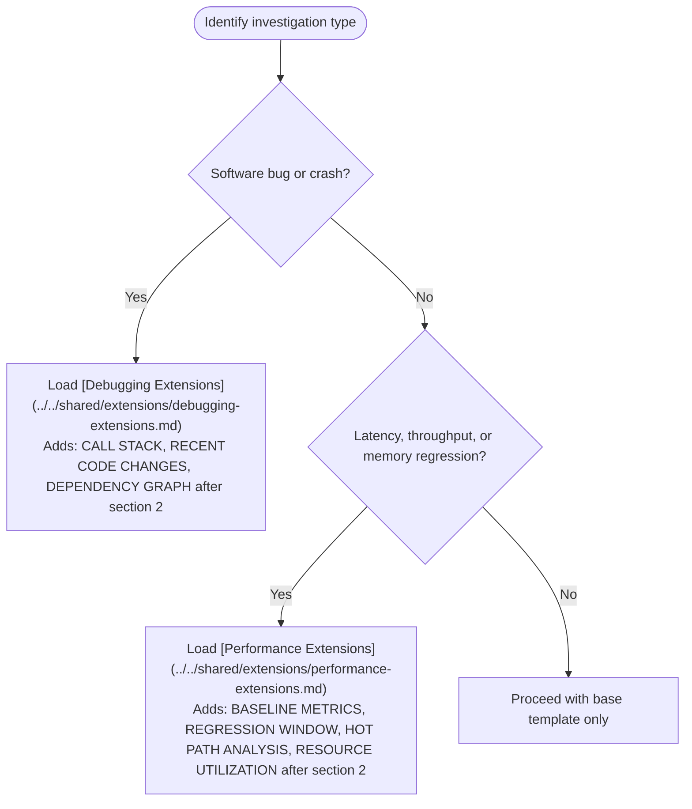
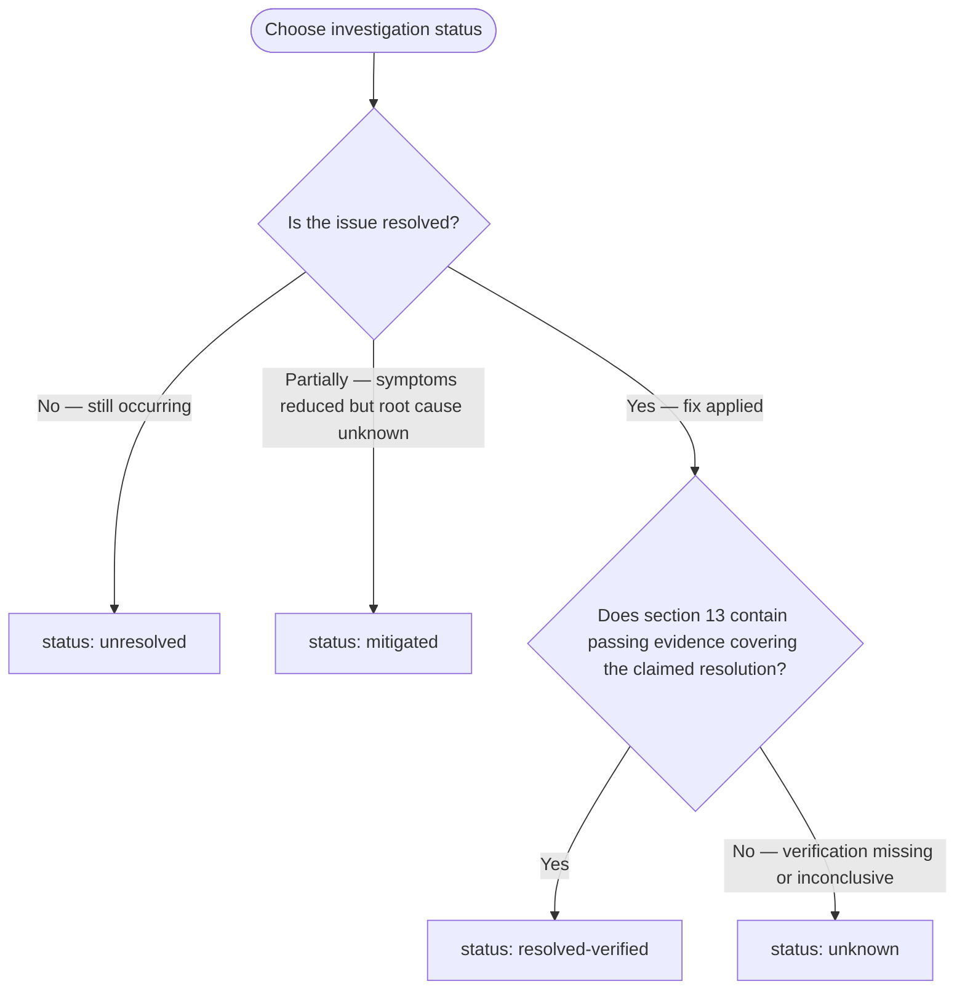

# Evidence-First Debugging

Primary responsibilities: observation recording, evidence IDs, causality validation, verification gates.

## Shared References

Load these references before producing any investigation output. A [references index](./references/shared-references.md) is available for a quick map of all shared files.

- [Unified Investigation Template](../../shared/investigation-template.md) — the 15-section output structure (sections 0–14)
- [Evidence Rules](../../shared/evidence-rules.md) — evidence ID format, truncation disclosure, forbidden phrases
- [Causality Gate](../../shared/causality-check.md) — classification rules for action-result links

## Domain Extensions

Load the applicable extension when the investigation type matches. Insert the extension's sections immediately after section 2 (OBSERVATIONS).



## Non-Negotiable Rules

Enforce these for every investigation output, without exception.

**Rule 1 — Facts only in FACTS / OBSERVATIONS / RESULTS**

Write only directly observed signals. Causal language is permitted only when the Causality Gate classification is `causal-supported`. No guesses, no interpretation, no speculation.

When an observation's coverage limits a conclusion or next action, add a `Limits:` note beside its evidence ID in section 2 (OBSERVATIONS). State what the observation cannot establish and the relevant missing coverage, such as component, time window, request identity, or log completeness. Omit limits that cannot affect the investigation; do not fill a boilerplate list.

For example, a client timeout establishes that the client did not receive a response before its deadline. It does not establish whether the server received or completed the request. Keep those dependent claims `UNKNOWN` in section 11 (CONCLUSION) until further evidence closes the gap. A missing log entry is not evidence of non-occurrence unless the source's coverage supports that inference.

**Rule 2 — Label every hypothesis explicitly**

Every hypothesis must state what it predicts and include a falsifiable test. Use the form:

```text
H1: [specific causal mechanism]
  Prediction: If H1 is true, we would observe [specific outcome]
  Falsification test: [what would disprove H1]
```

In section 6 (EXPERIMENT PLAN), choose the next feasible probe by its ability to distinguish the remaining hypotheses and change the next decision. Prefer a safe, low-cost probe with different expected outcomes over more evidence that every remaining hypothesis predicts. Do not invent competing hypotheses just to fill the template.

Before running the probe, record the hypotheses it separates, the expected outcome under each, and how each outcome changes the hypothesis decision or next action. Include an inconclusive branch for missing coverage or an unexpected result; retain the unresolved hypotheses rather than treating an inconclusive result as falsification. If no available probe distinguishes them, record the missing observation in section 11 and the next step needed to obtain it.

Example: after a client timeout, distinguish H1 (the server never received the request) from H2 (the server completed it but the response did not reach the client). Look up that request ID in server receipt/completion records with verified coverage of the relevant path and time window:

- H1 predicts no receipt or completion record; with complete coverage, investigate the request path before the server.
- H2 predicts a completion record; reject H1 and inspect the response path. Completion alone does not prove response loss.
- A receipt without completion rejects H1 but does not establish H2; investigate processing or revise the hypotheses.
- Incomplete records or uncertain request identity leave the comparison inconclusive; close the coverage gap before deciding.

**Rule 3 — Reserve `resolved-verified` for verified outcomes**

Output `status: resolved-verified` only when section 13 (Verification) contains a passing verification command with an evidence ID that covers the claimed resolution. Carry any unresolved coverage gap and the claim it prevents verifying into section 11; a passing narrow check cannot verify a broader claim. Unrelated unknowns do not block a scoped resolution, and verifying resolution does not itself prove a causal explanation. If section 13 is absent, empty, or insufficient for the claimed resolution, the status must be `mitigated`, `unresolved`, or `unknown`.

**Rule 4 — Cite evidence IDs on every claim**

Every statement in FACTS or RESULTS must end with an evidence ID in brackets — e.g., `[E3]`. Statements without a citable evidence ID must be labeled `UNKNOWN`.

**Rule 5 — Disclose all truncated output**

When any output is abbreviated, include a truncation disclosure block immediately after the snippet:

```text
TRUNCATED
total lines: <N>
shown: <M>
method: head | tail | grep
fingerprint: <sha256 or key tokens>
command: <exact command used>
```

Silent abbreviation is prohibited.

## Status Options

Choose exactly one per investigation output. Include it in section 14 of the investigation template.



## Output Checklist

Before emitting any investigation output, verify all items.

- [ ] Shared references loaded (investigation template, evidence rules, causality gate)
- [ ] Domain extension loaded if applicable (debugging or performance)
- [ ] All FACTS and RESULTS cite evidence IDs in brackets
- [ ] Decision-relevant observation limits and dependent `UNKNOWN` claims are recorded
- [ ] All hypotheses are labeled explicitly and include falsification tests
- [ ] Any next probe distinguishes remaining hypotheses, with expected outcomes, decision branches, and an inconclusive branch, or the missing observation is recorded
- [ ] All truncated output includes a TRUNCATION disclosure block
- [ ] Causality Gate classification present for every action-result link in section 10
- [ ] Status is exactly one of the four valid options
- [ ] `resolved-verified` is used only when section 13 contains passing verification evidence covering the claimed resolution
